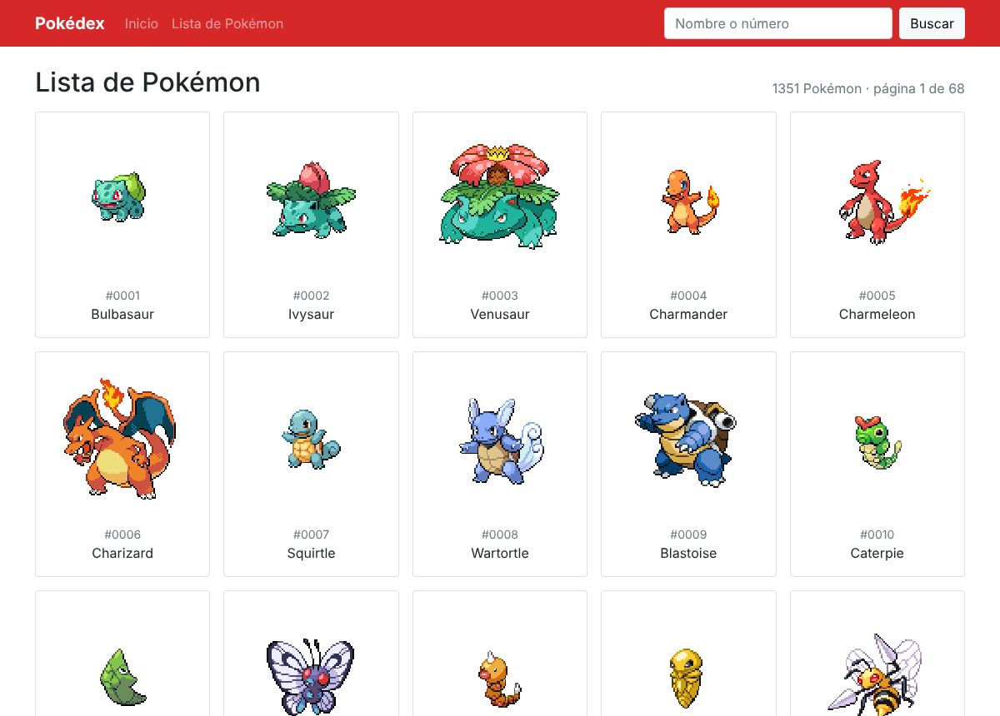
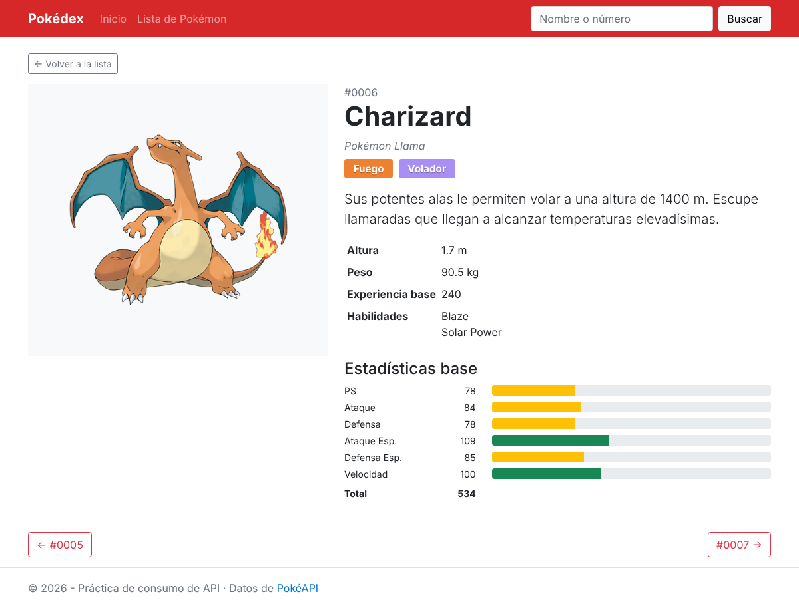
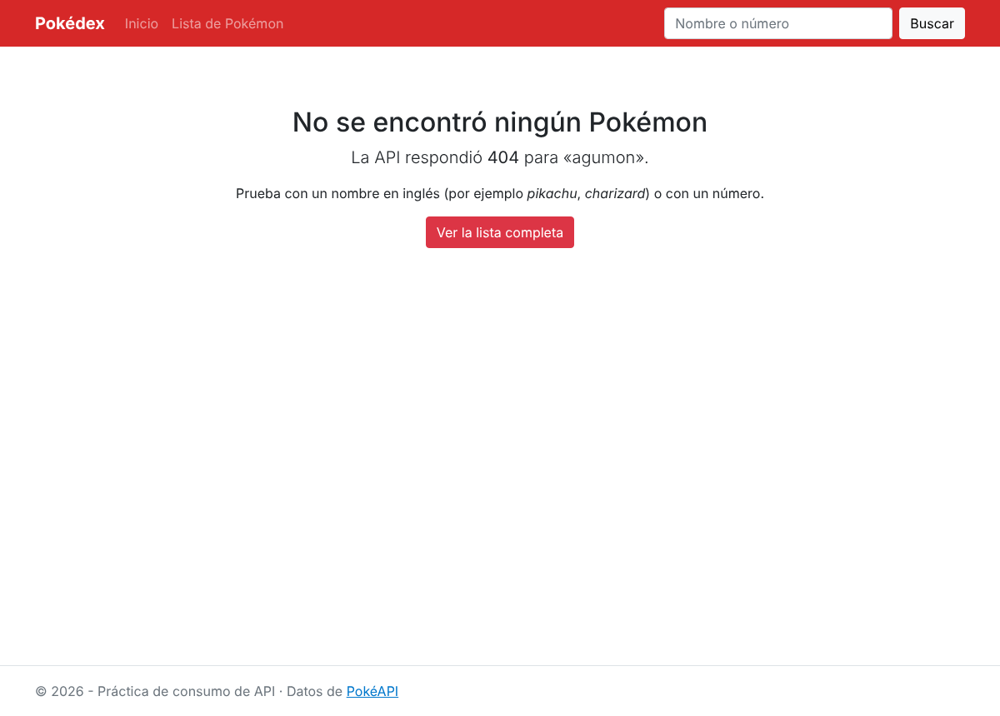

# PokeApiWebApp — Consumo de una API pública con ASP.NET Core MVC

Proyecto de práctica en **Visual Studio** (C#, ASP.NET Core MVC, .NET 8) que consume la
API pública **[PokéAPI](https://pokeapi.co)**. La aplicación implementa el proceso completo:

1. **Realizar la solicitud HTTP** a la API.
2. **Procesar la respuesta** (validar el código de estado y convertir el JSON a objetos C#).
3. **Mostrar los datos en pantalla** con vistas Razor y Bootstrap.

| Lista de Pokémon | Detalle |
|---|---|
|  |  |

---

## Requisitos y ejecución

- Visual Studio 2022 (17.8 o superior) con la carga de trabajo **"Desarrollo de ASP.NET y web"**.
- SDK de **.NET 8**.
- Conexión a internet (la PokéAPI es gratuita y **no necesita API key**).

**Desde Visual Studio:** abrir `PokeApiWebApp.sln` y pulsar **F5** (perfil `https` o `http`).

**Desde la terminal:**

```bash
cd PokeApiWebApp
dotnet run
```

Luego abrir `http://localhost:5025` en el navegador.

---

## Estructura del proyecto

```
PokeApiWebApp/
├── Program.cs                     ← Registro del HttpClient (inyección de dependencias)
├── appsettings.json               ← URL base de la API (PokeApi:BaseUrl)
├── Services/
│   ├── PokeApiService.cs          ← Solicitudes HTTP + deserialización del JSON
│   └── PokemonTranslations.cs     ← Traducción de tipos/estadísticas al español
├── Models/                        ← Clases que representan el JSON de la API
│   ├── NamedApiResource.cs
│   ├── PokemonListResponse.cs
│   ├── Pokemon.cs
│   └── PokemonSpecies.cs
├── ViewModels/                    ← Datos ya preparados para cada vista
│   ├── PokemonListViewModel.cs
│   └── PokemonDetailViewModel.cs
├── Controllers/
│   ├── HomeController.cs
│   └── PokemonController.cs       ← Index (lista), Details, Search
└── Views/
    ├── Home/Index.cshtml
    └── Pokemon/
        ├── Index.cshtml           ← Tarjetas + paginación
        ├── Details.cshtml         ← Imagen, tipos, datos y estadísticas
        ├── NotFound.cshtml        ← Cuando la API responde 404
        └── ApiError.cshtml        ← Cuando la API no responde
```

El flujo es el mismo que en el proyecto de referencia
[DigiApliWebApp](https://github.com/serdnaJ/DigiApliWebApp): **Controller → Service → API**,
y el resultado vuelve como **Model → View**.

```
Navegador ──► PokemonController ──► PokeApiService ──HTTP GET──► pokeapi.co
    ▲                │                     │                         │
    │                │                     ◄────── JSON ─────────────┘
    │                │          JsonSerializer → objetos C# (Models)
    │                ◄─────── Pokemon / PokemonListResponse
    │         arma el ViewModel
    └──── Vista Razor (.cshtml) genera el HTML
```

---

## Endpoints de la API utilizados

| Endpoint | Uso en la app |
|---|---|
| `GET https://pokeapi.co/api/v2/pokemon?offset=0&limit=20` | Listado paginado (20 por página) |
| `GET https://pokeapi.co/api/v2/pokemon/{nombre o id}` | Detalle: tipos, altura, peso, habilidades, estadísticas, imagen |
| `GET https://pokeapi.co/api/v2/pokemon-species/{id}` | Descripción y categoría **en español** |

Ejemplo (resumido) de la respuesta del listado:

```json
{
  "count": 1351,
  "next": "https://pokeapi.co/api/v2/pokemon?offset=20&limit=20",
  "previous": null,
  "results": [
    { "name": "bulbasaur", "url": "https://pokeapi.co/api/v2/pokemon/1/" },
    { "name": "ivysaur",   "url": "https://pokeapi.co/api/v2/pokemon/2/" }
  ]
}
```

---

## Procedimiento paso a paso

### Paso 1 — Crear el proyecto

En Visual Studio: **Crear un proyecto → "Aplicación web de ASP.NET Core (Modelo-Vista-Controlador)"**,
nombre `PokeApiWebApp`, framework **.NET 8.0**.
(Equivalente en terminal: `dotnet new mvc -n PokeApiWebApp`.)

No hace falta instalar paquetes NuGet: `HttpClient` y `System.Text.Json` vienen incluidos en .NET.

### Paso 2 — Crear los modelos a partir del JSON

Se crea una clase C# por cada objeto del JSON que se quiere leer. Con
`[JsonPropertyName]` se indica a qué propiedad del JSON corresponde cada una
(la API usa `snake_case`, por ejemplo `base_stat`). Los campos que no se mapean simplemente se ignoran.

```csharp
public class PokemonStat
{
    [JsonPropertyName("base_stat")]
    public int BaseStat { get; set; }

    [JsonPropertyName("stat")]
    public NamedApiResource Stat { get; set; } = new();
}
```

> Truco: en Visual Studio se puede copiar un JSON de ejemplo y usar
> **Editar → Pegado especial → Pegar JSON como clases** para generar los modelos automáticamente.

### Paso 3 — Registrar el `HttpClient` (Program.cs)

Se usa un **cliente tipado** con `IHttpClientFactory`. La URL base se lee de `appsettings.json`:

```csharp
builder.Services.AddHttpClient<PokeApiService>(client =>
{
    var baseUrl = builder.Configuration["PokeApi:BaseUrl"] ?? "https://pokeapi.co/api/v2/";
    client.BaseAddress = new Uri(baseUrl);
    client.Timeout = TimeSpan.FromSeconds(15);
});
```

¿Por qué no `new HttpClient()` en cada petición? Porque crear y destruir clientes
constantemente agota los sockets del sistema. `IHttpClientFactory` reutiliza las conexiones.

### Paso 4 — Realizar la solicitud y procesar la respuesta (Services/PokeApiService.cs)

```csharp
public async Task<PokemonListResponse> GetPokemonListAsync(int offset, int limit)
{
    // 1. Realizar la solicitud HTTP
    var response = await _httpClient.GetAsync($"pokemon?offset={offset}&limit={limit}");

    // 2. Verificar el código de estado (lanza HttpRequestException si no es 2xx)
    response.EnsureSuccessStatusCode();

    // 3. Leer el cuerpo de la respuesta como texto JSON
    var json = await response.Content.ReadAsStringAsync();

    // 4. Deserializar el JSON a objetos C#
    return JsonSerializer.Deserialize<PokemonListResponse>(json, JsonOptions)
           ?? new PokemonListResponse();
}
```

Para el detalle se trata el **404** como un caso normal (el usuario buscó un nombre que no existe)
y se devuelve `null` en lugar de lanzar una excepción:

```csharp
var response = await _httpClient.GetAsync($"pokemon/{clave}");
if (response.StatusCode == HttpStatusCode.NotFound)
    return null;

response.EnsureSuccessStatusCode();
return await response.Content.ReadFromJsonAsync<Pokemon>(JsonOptions);
```

### Paso 5 — El controlador (Controllers/PokemonController.cs)

El controlador recibe el servicio por **inyección de dependencias**, llama a la API,
arma un ViewModel y elige la vista. Los errores de red se capturan para mostrar un mensaje amigable:

```csharp
public async Task<IActionResult> Index(int page = 1)
{
    try
    {
        var data = await _service.GetPokemonListAsync((page - 1) * PageSize, PageSize);
        var model = new PokemonListViewModel
        {
            Pokemons = data.Results,
            CurrentPage = page,
            TotalCount = data.Count,
            TotalPages = (int)Math.Ceiling(data.Count / (double)PageSize)
        };
        return View(model);
    }
    catch (HttpRequestException ex)
    {
        return ApiError(ex);   // muestra Views/Pokemon/ApiError.cshtml
    }
}
```

Acciones disponibles:

| URL | Acción | Descripción |
|---|---|---|
| `/Pokemon?page=2` | `Index` | Lista paginada |
| `/Pokemon/Details/pikachu` o `/Pokemon/Details/25` | `Details` | Ficha del Pokémon |
| `/Pokemon/Search?query=Charizard` | `Search` | Redirige a `Details` (buscador del menú) |

### Paso 6 — Mostrar los datos (Views)

Las vistas Razor reciben el modelo y generan el HTML. Por ejemplo, las tarjetas del listado:

```cshtml
@foreach (var p in Model.Pokemons)
{
    <a class="card poke-card" asp-action="Details" asp-route-id="@p.Name">
        
        <div>#@p.Id.ToString("D4")</div>
        <div>@PokemonTranslations.DisplayName(p.Name)</div>
    </a>
}
```

El listado de la API solo trae `name` y `url`; el número se obtiene del final de la URL
(`.../pokemon/25/` → `25`) en `NamedApiResource.Id`, y con él se arma la URL de la imagen.
Así se evita hacer 20 peticiones extra por página.

En el detalle se convierten las unidades de la API (altura en decímetros → metros,
peso en hectogramos → kg) y las estadísticas se muestran como barras de progreso.

---

## Manejo de errores

| Situación | Qué hace la app | Código HTTP |
|---|---|---|
| El Pokémon no existe (la API responde 404) | Vista `NotFound` con sugerencias | 404 |
| La API no responde / sin internet | Vista `ApiError` con el detalle técnico | 502 |
| Falla solo `pokemon-species` | Se muestra el detalle sin la descripción | 200 |



---

## Posibles mejoras

- Guardar en caché las respuestas (`IMemoryCache`) para no repetir peticiones.
- Filtrar por tipo usando `GET /type/{nombre}`.
- Mostrar la cadena evolutiva con `GET /evolution-chain/{id}`.
